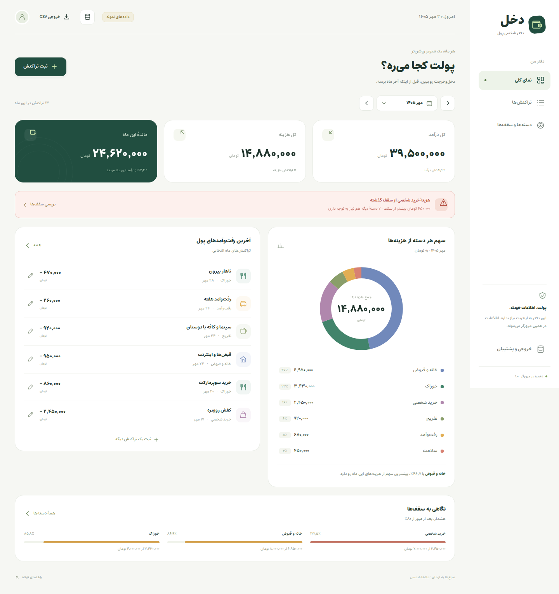
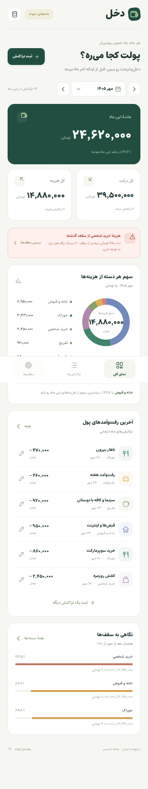

# DAKHL · دخل

[](https://github.com/alimokhtari-ai/alimokhtari-ai.github.io/actions/workflows/dakhl-ci.yml)

**A Persian personal finance app that runs from a single HTML file.**

Record income and expenses in tomans, explore spending by Jalali month, and see which categories are approaching their monthly limits. The interface is Persian and right-to-left; your ledger stays in your browser.

[**Open live demo**](https://alimokhtari-ai.github.io/dakhl/) · [راهنمای فارسی](docs/README-fa.md) · [Verification report](docs/QA-REVIEW.md) · [AI build prompts](docs/KEY-PROMPTS-fa.md)



*Screenshots use explicitly labeled sample data.*

## Open it

[Open the live app](https://alimokhtari-ai.github.io/dakhl/) and choose **دیدن دفتر نمونه** to explore it with labeled sample data. Each visitor's ledger stays in their own browser.

For an offline copy:

1. Download and extract the portfolio repository ZIP, then open its **`dakhl`** folder.
2. Open **`index.html`** inside that folder in a desktop browser.
3. Start with an empty ledger or choose the sample dataset.

No installation, server, account, API key or internet connection is required to use the app. CSS, JavaScript and the Persian font are embedded in the delivered HTML. The recorded browser checks use Chromium.

## What it does

- Add, edit and delete income or expenses, with amount, category, date and note; undo a deletion.
- View income, expenses, balance and category spending for a selected **Jalali month**.
- Create and rename categories; archive a category while preserving its transaction history.
- Set **independent monthly category limits** and receive a warning strictly above **80%**.
- Search and filter transactions; export CSV with Persian headers, numeric amounts and a UTF-8 BOM.
- Save locally and download or restore a validated JSON backup.
- Use a responsive RTL interface with Persian display digits, keyboard-operable dialogs and embedded Estedad typography.

### A few details that matter

| Decision | Result |
| --- | --- |
| The threshold is strictly `spent > 80% × limit` | Exactly 800 out of 1,000 does not warn; 801 does. Full and exceeded limits have distinct states. |
| Limits and totals are scoped to a Jalali month | Editing this month's cap does not rewrite last month's budget. |
| Amounts are validated integer tomans | Persian and Arabic digits are accepted; negative, fractional and unsafe values are rejected. |
| Imports are validated before replacement | Broken backups and invalid category references leave the current ledger intact. |
| Text is escaped and CSV cells are handled deliberately | Notes containing markup, commas, line breaks or formula-like text are covered by checks. |

## Mobile view



## Recorded verification

The repository includes the results of **15 core tests, 18 browser scenarios and 3 targeted regression scenarios**. The browser suite opened the actual `file://` app and observed no HTTP requests or JavaScript runtime errors.

| Scope | Recorded result | Evidence |
| --- | --- | --- |
| Financial logic, Jalali dates, CSV and validation | 15 passed; includes 1,150 daily calendar round trips | [Core output](tests/evidence/core-results.txt) |
| Forms, storage, imports, exports, limits, keyboard and responsive layout | 18 passed; widths 360, 390, 768 and 1440 px | [Browser results](tests/evidence/browser-results.json) |
| Concurrent-tab data changes and sample-data replacement | 3 passed | [Regression results](tests/evidence/regression-results.json) |

**Verification limits:** mobile viewports were tested in a desktop browser. Physical phones, Safari and the actual Microsoft Excel application were not tested. CSV bytes, encoding and structure were checked; Excel's import behavior can also depend on regional settings. See the [detailed review](docs/QA-REVIEW.md).

## Read, build and test

The app has no runtime dependencies. Development sources are split into `src/core.js`, `src/app.js`, `src/style.css` and `src/shell.html`. Run the commands below from the **`dakhl/`** project folder, alongside this README.

Rebuild the standalone HTML using Python 3's standard library:

```sh
python3 build.py
```

Run the core suite with Node.js; no package installation is needed:

```sh
node tests/core.test.cjs
```

Browser tests additionally require Playwright and its Chromium browser:

```sh
node tests/browser.test.cjs
node tests/regression.test.cjs
```

The included CI workflow runs the core suite and checks that rebuilding produces the committed `index.html`. Browser evidence is retained separately in `tests/evidence/`.

## Data and privacy

The app stores its ledger in `localStorage` and makes no network requests. There is no online account or cross-device synchronization. Browser data can be cleared, and storage behavior for local HTML files can vary by browser or file location. **Export a JSON backup before moving the file or clearing browser data.**

CSV is for analysis and spreadsheet use; JSON is the restorable backup format. A cap of zero means no limit has been set. The native date picker's language follows browser settings; the app's monthly reporting remains Jalali.

## شروع سریع فارسی

بعد از دانلود مخزن، وارد پوشهٔ **`dakhl`** شو و فایل **`index.html`** را باز کن؛ نصب و سرور لازم نیست. مبلغ‌ها تومان‌اند و گزارش هر ماه با تقویم شمسی محاسبه می‌شود. می‌توانی با دفتر خالی شروع کنی یا نمونهٔ مشخص‌شده را ببینی. قبل از جابه‌جایی فایل یا پاک کردن داده‌های مرورگر، پشتیبان JSON بگیر.

[راهنمای کامل فارسی](docs/README-fa.md) · [پنج پرامپت کلیدی](docs/KEY-PROMPTS-fa.md) · [سناریوی ارائه](docs/DEMO-SCRIPT-fa.md)

---

Built by **Ali Mokhtari** for the **Vibe Coder challenge · VC-005**, with an AI-assisted implementation and explicit acceptance checks.

Typography: **Estedad 8.5**, distributed with its [SIL Open Font License](assets/OFL-Estedad.txt). Font provenance and checksum are recorded in the [asset manifest](assets/font-manifest.json).
