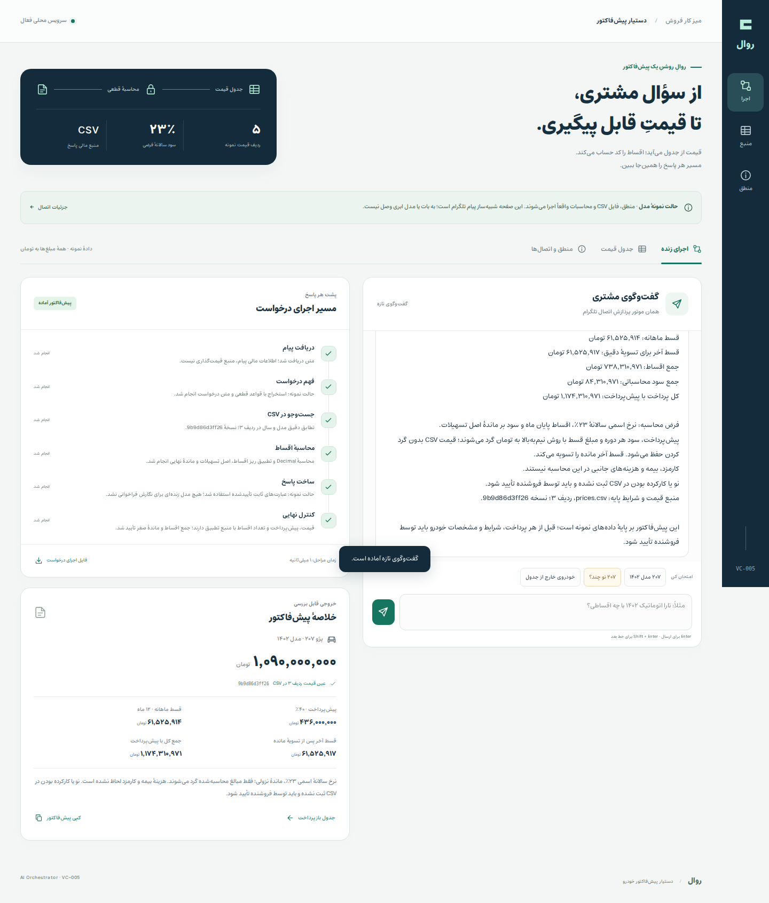

# روال · RAVAL

**دستیار پیش‌فاکتور خودرو · VC-005 · AI Orchestrator**

[](https://github.com/alimokhtari-ai/alimokhtari-ai.github.io/actions/workflows/raval-ci.yml)

[تماشای اجرای پروژه](https://alimokhtari-ai.github.io/raval/) · [دریافت ZIP کامل](https://alimokhtari-ai.github.io/raval/releases/RAVAL-VC005.zip) · [ویدیوی ۱ دقیقه و ۴۵ ثانیه‌ای](https://alimokhtari-ai.github.io/raval/releases/RAVAL-VC005-Demo-Web.mp4) · [گزارش بررسی](docs/VERIFICATION-fa.md)

A Persian vehicle-quote workflow with exact CSV prices, code-calculated repayments, and visible source provenance. The delivered demo runs a real local Python service in fixture mode. Telegram and Groq adapters are included; live integrations are not enabled or verified in this recording.

روال درخواست مشتری را می‌گیرد، خودرو و سال را مشخص می‌کند، ردیف مرتبط را از CSV می‌خواند و پیش‌پرداخت و اقساط را با کد محاسبه می‌کند. مسیر شش‌مرحله‌ای هر درخواست و منبع عددها در کنار پاسخ قابل بررسی است.

**وضعیت نسخهٔ تحویلی:** سرور محلی و خواندن CSV واقعی‌اند. حالت پیش‌فرض مدل، `fixture` با قواعد قطعی است و پنل پیام‌رسان، شبیه‌ساز تلگرام است. برای Groq یا تلگرام واقعی کلید و اتصال زنده‌ای در این بسته وجود ندارد. قیمت‌ها دادهٔ نمونهٔ تسک‌اند و قیمت بازار نیستند.

صفحهٔ آنلاین برای تماشای نسخهٔ سبک‌شدهٔ همان ویدیوی تحویلی و دریافت فایل‌هاست. استفادهٔ تعاملی از برنامه به اجرای سرور پایتون نیاز دارد. فایل ZIP همان نسخهٔ تحویل‌شده است؛ فایل‌های معرفی و تنظیم CI در گیت‌هاب جداگانه اضافه شده‌اند.



## اجرا در یک دقیقه

به **Python 3.10 یا جدیدتر** نیاز دارید. تمام برنامه از کتابخانهٔ استاندارد پایتون استفاده می‌کند؛ نصب پکیج لازم نیست.

ZIP را باز کنید و در پوشهٔ پروژه اجرا کنید. اگر کل این ریپو را clone کرده‌اید، ابتدا وارد پوشهٔ `raval` شوید:

```sh
python3 server.py
```

سپس [http://127.0.0.1:8765](http://127.0.0.1:8765) را در مرورگر باز کنید. ترمینال باید هنگام استفاده باز بماند؛ برای توقف، `Ctrl+C` بزنید.

- **Mac:** فایل `start-mac.command` سرور را راه می‌اندازد و درخواست باز شدن مرورگر را می‌دهد. اگر اجازهٔ اجرا نداشت، یک بار `chmod +x start-mac.command` را اجرا کنید.
- **Windows:** فایل `start-windows.bat` را باز کنید. این فایل ابتدا Python Launcher و سپس دستور `python` را بررسی می‌کند.
- **اجرای مستقیم در Windows:** `py -3 server.py` و همان نشانی مرورگر.

این پروژه با دوبار کلیک روی HTML اجرا نمی‌شود؛ رابط از موتور محلی پایتون پاسخ می‌گیرد. برای تغییر پورت می‌توانید از `python3 server.py --port 8766` استفاده کنید و نشانی متناظر را باز کنید.

## سه درخواست برای شروع

1. `قیمت و اقساط ۲۰۷ مدل ۱۴۰۲ رو بگو` برای پیش‌فاکتور یک ردیف مشخص.
2. `۲۰۷ نو چند؟` برای دیدن سؤال تکمیلی سال. «نو» جای سال را نمی‌گیرد و وضعیت نو یا کارکرده در جدول ثبت نشده است. بعد در همان گفت‌وگو `۱۴۰۲` را بفرستید.
3. یک مدل یا سال غایب از جدول را بخواهید تا حداکثر سه گزینهٔ موجود در **خود جدول** پیشنهاد شود. این گزینه‌ها تأیید موجودی فیزیکی خودرو نیستند و بدون انتخاب مشتری جایگزین درخواست نمی‌شوند.

## مسیر شش‌مرحله‌ای

| مرحله | کار مشخص |
| --- | --- |
| دریافت | ثبت شناسهٔ درخواست، گفت‌وگوی مستقل و جلوگیری از اجرای تکراری همان درخواست |
| استخراج | تشخیص مدل، سال و اشاره به وضعیت خودرو؛ کنترل نتیجه با متن و زمینهٔ مجاز |
| جست‌وجوی منبع | خواندن و اعتبارسنجی CSV فعلی؛ تطبیق دقیق مدل و سال |
| محاسبه | محاسبهٔ پیش‌پرداخت و جدول اقساط با `Decimal` |
| ساخت پاسخ | کنار هم گذاشتن متن‌های تأییدشده و بخش مالی تولیدشده با کد |
| اعتبارسنجی | بررسی خروجی و ثبت ردیف و نسخهٔ منبع پیش از تحویل پاسخ |

اگر اطلاعات کافی نباشد، مسیر به سؤال تکمیلی یا گزینه‌های واقعی جدول می‌رسد؛ مراحل اجرا‌نشده با وضعیت مناسب نشان داده می‌شوند. زمان مراحل از اجرای واقعی می‌آید. درخواست تکراری با همان شناسه از نتیجهٔ ثبت‌شده بازیابی می‌شود.

`workflow.json` شرح قابل‌خواندن همین مسیر است. **این فایل خروجی قابل Import در n8n نیست.** اجرای پروژه با پایتون انجام می‌شود.

## عددها از کجا می‌آیند؟

منبع قیمت، درصد پیش‌پرداخت و تعداد اقساط، فایل `data/prices.csv` است. سرستون‌ها باید دقیقاً این‌ها باشند:

```csv
خودرو,سال,قیمت,درصد پیش‌پرداخت,تعداد اقساط
```

قیمت خودرو بدون گرد کردن استفاده می‌شود. در نسخهٔ اتصال به مدل نیز قیمت و شرایط مالی به مدل ارسال نمی‌شوند؛ مدل فقط مشخصات درخواست و شناسهٔ متن‌های مجاز را انتخاب می‌کند. بخش مالی پاسخ را موتور پایتون می‌سازد. تغییر قیمت در متن مشتری، منبع قیمت محسوب نمی‌شود.

هر پیش‌فاکتور ردیف و نسخهٔ CSV را همراه دارد. ویرایش جدول از رابط با اعتبارسنجی و کنترل نسخه انجام می‌شود. پیش از تغییر فایل نمونه، یک کپی از آن نگه دارید.

## فرض محاسبهٔ اقساط

پیش‌فرض، **نرخ اسمی سالانهٔ ۲۳٪**، اقساط پایان ماه و محاسبه بر ماندهٔ بدهی است. نرخ ماهانه `23/1200` است. هزینهٔ بیمه، کارمزد و هزینه‌های جانبی در محاسبه وارد نشده‌اند.

فقط مبلغ‌های محاسبه‌شده به تومان کامل و با قاعدهٔ `ROUND_HALF_UP` گرد می‌شوند. قیمت CSV تغییر نمی‌کند. سود هر دوره نیز با همین قاعده ثبت می‌شود؛ قسط آخر باقی‌مانده را تسویه می‌کند و اگر با اقساط قبل فرق داشته باشد، جدا نمایش داده می‌شود.

[فرمول، جدول اقساط و سیاست دقیق گرد کردن](docs/FINANCE-fa.md)

## اتصال‌های اختیاری

- برای Groq، متغیرهای محیطی `QUOTE_LLM_PROVIDER`، `GROQ_API_KEY` و `QUOTE_LLM_MODEL` تنظیم می‌شوند.
- برای تلگرام واقعی، `TELEGRAM_BOT_TOKEN` و `TELEGRAM_ALLOWED_CHAT_IDS` لازم‌اند و آداپتور جداگانه اجرا می‌شود.
- `.env.example` فقط الگوی نام متغیرهاست. فایل `.env` به‌صورت خودکار خوانده نمی‌شود.
- محتوای درخواست برای استخراج در حالت Groq به سرویس مدل فرستاده می‌شود؛ حالت پیش‌فرض fixture به سرویس مدل نیاز ندارد.

[راهنمای اتصال و چک‌لیست بررسی](docs/CONNECTING-fa.md)

## فایل‌های مهم

| مسیر | نقش |
| --- | --- |
| `server.py` و `web/` | سرور محلی و رابط فارسی |
| `workflow.py` | اتصال مراحل، سابقه و شناسهٔ درخواست |
| `quote_engine.py` | تطبیق منبع، محاسبات و ساخت پیش‌فاکتور |
| `model_gateway.py` | حالت fixture و آداپتور اختیاری Groq |
| `telegram_bot.py` | آداپتور اختیاری تلگرام با long polling |
| `data/prices.csv` | جدول قیمت آموزشی تسک |
| `prompts/` | پنج پرامپت اصلی ساخت و بررسی |
| `docs/WALKTHROUGH-fa.md` | مسیر پیشنهادی ویدیوی کوتاه |
| `docs/PROJECT-EXPLANATION-fa.md` | توضیح کوتاه معماری و فرایند کار |
| `docs/SOURCES.md` | منابع فنی و مرز ادعاها |

## دادهٔ محلی و محدودهٔ نسخه

سرور به‌صورت پیش‌فرض فقط روی `127.0.0.1` گوش می‌دهد. سابقه و شناسه‌های درخواست در SQLite محلی نگه داشته می‌شوند و زمینهٔ کوتاه گفت‌وگو پس از ۱۵ دقیقه منقضی می‌شود. فایل‌های زمان اجرا و هیچ رمز یا توکنی نباید وارد بستهٔ ارسال شوند.

جدول شامل موجودی، نو یا کارکرده بودن، رنگ و جزئیات قرارداد فروش نیست. پیش‌فاکتور این دمو بر اساس همان دادهٔ نمونه و فرض نرخ اعلام‌شده ساخته می‌شود؛ تأیید این موارد نیازمند دادهٔ جداگانه است. اتصال زندهٔ مدل یا تلگرام و نتیجهٔ آزمون‌ها فقط با شواهد همان اجرا قابل تأییدند.

## بررسی و کیفیت

۸۰ آزمون پایتون و ۱۵ سناریوی مرورگری موفق بوده‌اند. آزمون‌های اتصال خارجی از transport ساختگی استفاده می‌کنند؛ نتیجهٔ آن‌ها تأیید تماس زنده نیست. [گزارش کامل بررسی و محدودیت‌ها](docs/VERIFICATION-fa.md) و [گزارش مرورگر](evidence/browser-results.json) همراه پروژه‌اند.

```sh
python3 -m unittest discover -s tests -p 'test_*.py' -v
```

CI گیت‌هاب همان آزمون‌های پایتون را روی نسخه‌های ۳٫۱۰ و ۳٫۱۲ اجرا می‌کند و یک اجرای مستقل از ۱۵ سناریوی مرورگر دارد. وضعیت آخرین اجرا از نشان بالای این صفحه و جزئیات [GitHub Actions](https://github.com/alimokhtari-ai/alimokhtari-ai.github.io/actions/workflows/raval-ci.yml) قابل بررسی است. این بررسی‌ها از مدل نمونه و transport ساختگی برای سرویس‌های خارجی استفاده می‌کنند.

برای اجرای اختیاری تست مرورگر، Node.js 24 و Playwright 1.62.1 توسعه‌ای لازم‌اند. در پوشهٔ `raval` یا پوشهٔ استخراج‌شدهٔ ZIP اجرا کنید:

```sh
npm install --no-save --package-lock=false --ignore-scripts --no-audit --no-fund playwright@1.62.1
npx --no-install playwright install chromium
node tests/browser.test.cjs
```

در Linux، اگر کتابخانه‌های سیستمی مرورگر نصب نیستند، دستور نصب مرورگر را با `npx --no-install playwright install --with-deps chromium` اجرا کنید. آزمون مرورگر از CSV و SQLite موقت استفاده می‌کند و گزارش را در `evidence/browser-results.json` می‌نویسد. نصب npm صرفاً برای این آزمون توسعه‌ای است؛ خود برنامه هیچ وابستگی npm یا pip ندارد.

فونت Estedad نسخهٔ ۸٫۵، با مجوز OFL، از فایل محلی بارگیری می‌شود. مشخصات منبع و هش فایل در `web/assets/font-manifest.json` و متن مجوز در همان پوشه است.

[متن معرفی و راهنمای ارسال به بات](docs/SUBMISSION-fa.md)

